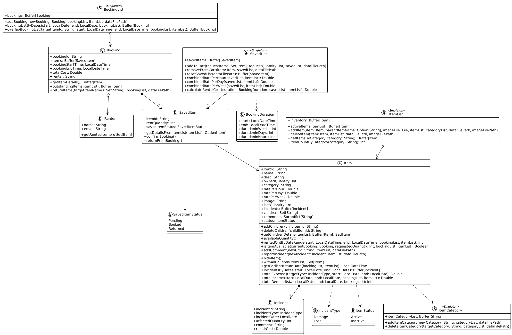

# Rental Store

A desktop rental management app for tracking inventory and reservations, built with Scala and ScalaFX. This project is part of course CS-C2105 - Programming Studio at Aalto University.

**Tech stack:** Scala · ScalaFX · sbt · local JSON storage · JDK 21+

## What I Learned

- Planning and documenting a system from design through to completion
- Object-oriented design in Scala
- Building a desktop GUI with ScalaFX
- Persisting application data as JSON

## Features

**Inventory management**
- Add and delete items, and view item details
- Bundle items for package rental
- Add comments to items
- Report an item as lost or damaged
- Manage item categories
 
**Rentals**
- Rent and return items
- Manage renters
- View item reservations in a calendar view

**Reporting**
- Generate finance and incident reports for a chosen date range


## Build & Run

- **JDK 21 or higher.** Check your version with `java -version`.
- **sbt and Scala.** Install them with Coursier by following the [official installation guide](https://www.scala-lang.org/download/) for your OS. On Linux x86_64:
```bash
  curl -fL https://github.com/coursier/coursier/releases/latest/download/cs-x86_64-pc-linux.gz | gzip -d > cs && chmod +x cs && ./cs setup
```

### Run the app

```bash
git clone https://github.com/linhhvo/rental-store-app.git
cd rental-store-app
sbt run
```
## Data Storage

The app stores all data as JSON files in `src/main/resources/data/`. The files in the repository contain sample data, and the app updates them as you add items, bookings and renters. To start from a clean state, restore the files from Git with `git checkout -- src/main/resources/data`.

### Files Format

*items.json*

```json
[
  {
    "name": "laptop",
    "desc": "a nice laptop",
    "ownedQuantity": 1,
    "category": "ELECTRONICS",
    "ratePerHour": 10,
    "ratePerDay": 20,
    "ratePerWeek": 30,
    "itemId": "GeVzJx4q4pkvxEacJ9lcG",
    "incidents": [
      {
        "incidentType": "Loss",
        "incidentDate": "4-11-2025",
        "affectedQuantity": 1,
        "comment": "404",
        "repairCost": 100,
        "incidentId": "lF1Qj27aeGbqkq1ne3k9Z"
      }
    ],
    "children": [
      "6vzT5wnEjKUUlEycO6BoD"
    ],
    "image": "laptop.png",
    "comments": [
      "good laptop"
    ],
    "lostQuantity": 1,
    "status": "Active"
  }
]
```

*bookings.json*

```json
[
  {
    "items": [
      {
        "itemId": "1LtFH0dWt0L0mDGtLTr90",
        "rentQuantity": 2,
        "savedItemStatus": "Booked"
      }
    ],
    "bookingStartTime": "10-12-2025 11:00",
    "bookingEndTime": "12-12-2025 12:00",
    "totalCost": 420,
    "renter": "renter1",
    "bookingId": "aQPHakxa82K98B3VR5z8W"
  }
]
```

*renters.json*

```json
[
  {
    "name": "renter1",
    "email": "renter1@email.com"
  },
  {
    "name": "renter2",
    "email": "renter2@email.com"
  }
]
```

*itemCategories.json*
```json
["CAMPING", "COOKING"]
```
## Architecture

The code is split into two layers:

- **`logic/`**: the domain model (items, bookings, renters, incidents), the lists that manage them, and the JSON persistence in `util/IOHandler.scala`.
- **`ui/`**: the ScalaFX views and the reusable components and validators in `ui/util/`.
 
<details>
<summary>Project structure</summary>

```text
src/main
├── resources
│   ├── data
│   │   ├── bookings.json
│   │   ├── itemCategories.json
│   │   ├── items.json
│   │   ├── renters.json
│   │   └── savedItems.json
│   └── images
│       └── tent.png
└── scala
    ├── logic
    │   ├── BookingList.scala
    │   ├── Booking.scala
    │   ├── enums
    │   │   ├── IncidentType.scala
    │   │   ├── ItemStatus.scala
    │   │   └── SavedItemStatus.scala
    │   ├── Incident.scala
    │   ├── ItemCategory.scala
    │   ├── ItemList.scala
    │   ├── Item.scala
    │   ├── Renter.scala
    │   ├── SavedItem.scala
    │   ├── SavedList.scala
    │   └── util
    │       ├── BookingDuration.scala
    │       ├── CustomExceptions.scala
    │       └── IOHandler.scala
    └── ui
        ├── AddItemCategory.scala
        ├── AddItem.scala
        ├── BodyContainer.scala
        ├── CalendarPage.scala
        ├── ItemDetails.scala
        ├── ItemGrid.scala
        ├── Main.scala
        ├── MenuBar.scala
        ├── RentItem.scala
        ├── ReportPage.scala
        ├── ReturnItem.scala
        ├── util
        │   ├── DateTimePicker.scala
        │   ├── Helper.scala
        │   ├── RenterPicker.scala
        │   └── Validator.scala
        └── ViewRenter.scala
```
</details>

## Class Diagram

